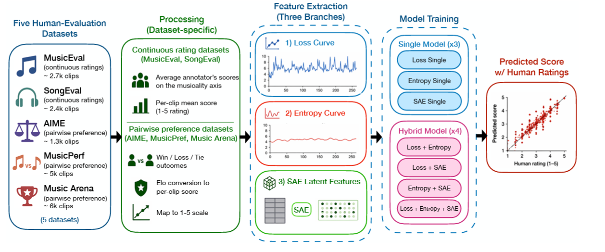
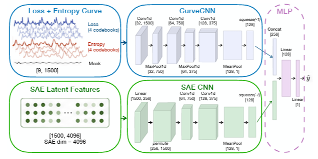
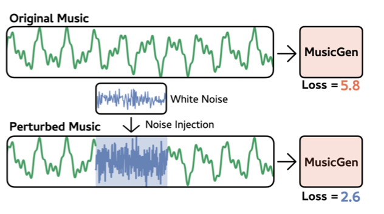

# Desing proposal

## Topic

| The question | *Do a generator's intrinsic signals rate other generators' outputs the way listeners do, do they beat the prompt-only floor, and do they survive few-step acceleration?* |
| --- | --- |
| Starting point | The intrinsic-signal result was shown for MusicGen on a dataset of human ratings. Learned evaluators (networks trained to predict ratings) and audio-language judges are the alternatives, and both are known to follow the prompt in part. Accelerated text-to-audio models with released weights exist beside their full-step teachers. No paper we read uses one model's signals on another model's outputs, or tests the signals against a floor or after acceleration. |
| First steps | <ol><li>Reproduce the correlation between MusicGen's intrinsic signals and the MusicEval human ratings on 300 clips.</li><li>Apply MusicGen's signals to 300 clips generated by Stable Audio Open and compare with the ratings; read whether the correlation holds.</li><li>Write down the result that would refute the project.</li></ol> |
| Plan | <ol><li>Intrinsic signals (loss, hidden-state features) for three open generators, each scoring its own outputs and the other two models' outputs on MusicEval and SongEval; a self-preference measure per model (how much higher a model ranks its own outputs than listeners do).</li><li>The prompt-only floor computed on the same clips; the correlation of each signal with ratings after the floor is removed.</li><li>The same signals on a teacher and its few-step student, with the loss replaced by a proxy where the student has none.</li><li>A short listening check on 100 clips where the signals and listeners disagree most, and the paper.</li></ol> |
| Results either way | If signals rate other models fairly and beat the floor, the field gets a free evaluator and the paper says how to use it. If signals prefer their own outputs or collapse to the floor or after acceleration, the paper says when they cannot be used, which every leaderboard that uses them needs to know. |
| What would refute it | Every model's signals rank every other model's outputs as listeners do, beat the floor, and survive acceleration with correlation within 0.05 of the teacher's. |
| Paper | ISMIR 2027; ICASSP 2028. |
| Needs | It needs MusicEval and SongEval (public ratings), three open generators including a teacher and its accelerated student, one workstation GPU for inference, and a few listeners for the check. It needs no human study. |
| Compute | one workstation GPU |
| Human study | None. The team's own listening is a check, not a study. |
| Main risk | Hidden-state features can be chosen to fit the ratings. Fix the feature set on one dataset and report the other without further tuning. |
| Read first | <ul><li>[Do Music Generative Models Understand Musical Qualities? Automatic Music Evaluation with Model-Intrinsic Signals](https://arxiv.org/abs/2609.37710)</li><li>[MuQ-Eval: An Open-Source Per-Sample Quality Metric for AI Music Generation Evaluation](https://arxiv.org/abs/2603.22677)</li><li>[MusicEval: A Generative Music Dataset with Expert Ratings for Automatic Text-to-Music Evaluation](https://arxiv.org/abs/2501.10811)</li><li>[SongEval: A Benchmark Dataset for Song Aesthetics Evaluation](https://arxiv.org/abs/2505.10793)</li><li>[Fast Text-to-Audio Generation with Adversarial Post-Training](https://arxiv.org/abs/2505.08175)</li></ul> |

## Schedule

| Tydzień | Deadline | Opis |
| --- | --- | --- |
| #1 (14.10-21.10) | 21.10 - desing proposal | Design proposal, wstępny przegląd literatury |
| #2 (22.10-28.10) |  | Przegląd literatury, wybranie modeli do analizy, zbiorów testowych, reprodukcja korelacji (z opisu) |
| #3 (29.10-04.11) | 4.11 - zgłoszenie gotowości prototypu | przygotowanie środowiska ewaluacyjnego (pozwalającego na reprodukowalność wyników), wyniki podważające projekt (jeśli takie są), prototyp (wykorzystanie sygnału do oceny jednego z modeli, prosty klasyfikator) |
| #4 (5.11-11.11) | 10.11 - deadline pierwsze spotkanie | spotkanie, sprawdzić inne modele (które oceniamy) pod kątem oceny i korelacji |
| #5 (12.11-18.11) | standup 1 / 2 | eksperymenty z innymi modelami / metodami (czyli klasyfikatorami) bazującymi na sygnale |
| #6 (19.11-25.11) |  |  |
| #7 (26.11-2.12) |  |  |
| #8 (3.12-9.12) |  |  |
| #9 (10.12-16.12) |  |  |
| #10 (17.12-23.12) |  |  |
| #11 (24.12-30.12) |  |  |
| #12 (31.12-6.01) |  |  |
| #13 (7.01-13.01) |  | spisanie artykułu, opracowanie wyników eksperymentów, zadbanie o kod i refaktor |
| #14 (14.01-15.01) | 15.01 - deadline | poprawki do artykułu, zgłoszenie |

## 1. Music Generation Models

### MusicGen Small (Meta)

An autoregressive music generation model used in the study by Li et al. (2026). It allows the extraction of three intrinsic signals: prediction loss, prediction entropy, and SAE features. It will be used to reproduce the results of previous research.

### Stable Audio 3 Small Music Base (Stability AI) — Teacher

A base music generation model that will serve as a reference for studying the effects of model acceleration. It acts as the teacher, meaning that its performance will be compared with that of the accelerated version. We will investigate whether its intrinsic signals correlate with human ratings.

### Stable Audio 3 Small Music (Stability AI) — Accelerated Model

A version of the model that has undergone acceleration through post-training. It acts as the student in the experiment, generating music faster using fewer steps. It will allow us to investigate whether acceleration affects the effectiveness of music quality evaluation based on intrinsic signals.

## 2. External Evaluation Models (Judges)

To assess the effectiveness of intrinsic signals, we will compare their results with those of existing automatic music evaluation models.

### MuQ-Eval (Zhu & Li, 2026)

A model that predicts human music quality ratings based on audio. It will serve as the main baseline. Since it was trained on MusicEval, appropriate data splits must be considered.

### Audiobox Aesthetics (Meta)

A model that evaluates audio aesthetics, including Production Quality and Content Enjoyment. It will serve as an additional, independent audio quality evaluator.

### LAION-CLAP

A model that measures similarity between text and audio. It will be used to evaluate how well the generated music matches the text prompt, rather than directly assessing its overall quality.

## 3. Benchmarks

### MusicEval (Liu et al., 2025)

A dataset containing 2,748 music clips from 31 generators, rated by experts. It will serve as the main benchmark for reproducing previous results and comparing correlations with human ratings.

### MusicPrefs

A dataset containing pairwise comparisons of music clips evaluated by listeners. It will be used to investigate self-preference, meaning whether models favor their own generated outputs.

### AIME

A benchmark containing human preferences for AI-generated music. It will be used to evaluate whether the results generalize to another dataset.

### SongEval (Yao et al., 2025)

A benchmark evaluating the aesthetics of full-length songs, including musicality, coherence, and vocals. It will be used to test whether the method works on longer and more complex musical pieces.

## Initial literature review - starting point

**Search query: Using music generator's intrinstic signal to predict human ratings of generated music samples**

The paper by Li et al. (2026) uses MusicGen music generator model developed by Meta to test wheter it's intrinsic signals can be used to predict human ratings. The following signals from the model are used:
* Predicton Loss
* Prediction entropy
*  Concepts extracted from the model using a sparse autoencoder (SAE)
The authors use five open music evaluation datasets to test their approach:
* MusicEval
* SongEval
* MusicPref
* AIME
* Music Arena

The general finding are that if the model is confident and wrong with its predictions vs true tokens (low entropy, high loss) the lower the human rating of the song. The concepts (internal representations) captured using SAE also seem to separate good audio form purely generated samples.

### The experiment setup

The generator model of choice is the original pre-trained, auto-regressive model MusicGen from Meta.

Three intrinstic signals from the model are captured:

**Loss Curve**. This is to model listener's surprise. This is to check how likely it would be that for a given sequence the model would generate something similar. More concretely its the negative log-likelyhood of the ground truth token under the model's next-token distribution:
$l_{t} = -logp_{\theta}(x_{t}|x_{<t})$

If the model finds that its highly probable to get ground truth token $x_{t}$ given the previous ground truth token $x_{t-1}$ then they loss is close to 0.

**Predictive Entropy**. This models how uncertain the listener is about what come net. It computes the entropy $p_{\theta}(*|x_{<t})$. 

**SAE Latents**. They aim to capture models internal representation of given sample, which may capture the general music concepts like timbre, register or harmony. For this task a previously developed model by Singh et. al (2025) is used. This model uses Sparse Auto-Encoders (SAE) which takes in the generator's internal activations, passes them through SAE and outputs 4,096 sparse feature set.

**The prediction model**. The model is a deep neural network, consisting of two 1D-CNN encoder one for Loss and Entropy curve and one for the SAE Latent features. The outputs of these CNN layers are concatenated and fed through a MLP which produces values (music ratings) in range $[1,5]$.

## Other works

**When Noise Lowers the Loss: Rethinking Likelihood-Based Evaluation in Music Large Language Models (Li et al., 2026).**

In this papers authors took the MusicGen model a tested how its prediction loss changes when music samples are distorted with added noise. The important finding here is that adding noise does not always make the prediction loss higher. Low prediction loss in itself seem not enough to gauge wheter music sample is good or bad  - the general pattern or curve of the loss is more informative

**The experiment setup**

Take pairs of audio samples, original and one with added noise.  Compute token-wise prediction loss curves for each. Compute the delta between the curves.

**Percieving music quality with GANs (Hilmkil, Thome, Arpteg, 2020)**

The authors use GAN discriminator to evaluate music quality without training it on human ratings. The GAN was setup in the following way:
* Generator tries to generate realistic music.
* Disriminator tries to tell apart real music from generated.

After training the use the Discriminator as a music-quality judge. They provide the discriminator with a real music sample and use its output as a score of music quality.

To train a model a data was sampled from the Epidemic Sound library which contains profesionally recorded audio clips across different genres. This was used to train the GAN and a held out set was used to test it. The held out set was also independently rated by humans. The held out set was further enriched but adding distorted version of the clips.

Finally the authors used spearman's correlation coefficient to calculate the correaltion between raw Discriminator score and rating on 1-5 scale.

The finding was that in general the Disriminator outputs had a positive correlation with human ratings.

## Initial experiments and first results

We conducted an initial experiment to check if the results described by Li et al. (2026) ([MEva](https://github.com/YoEv/MEva/tree/main)) could be reproduced. We use the smaller variant of MusicGen - `facebook/musicgen-small`. We selected the the loss and entropy signals and 3 variants described by the authors:
1. single-loss (prediction based on loss)
2. single-entropy (prediction based on entropy)
3. loss-entropy (prediction based on both loss and entropy)

the SAE variants (using latents from SAE) were held out for now and to test later. We used the [MusicEval dataset](https://huggingface.co/datasets/BAAI/MusicEval) (Liu et al., 2025), which is one of the subsets used in MEva paper. It already contains the train / dev / test splits. The authors report in the paper that they use the custom stratified splits, we follow their approach and generated corresponding splits using their script. For the feature extraction, we use authors approach and code (`external/meva/lib/repro/musicgen_pattern.py`). The classification model was copied directly from the authors' code (`music_gen_eval/meva/nets.py`). The experiments follow same hyperparameters as described by authors, while at the end we pick the best performing checkpoint on the dev split by MSE loss value. We provide our own implementation for training loop and evaluation suite, but follow authors guidelines and parameters setup. For now we evaluate the single seed, future work should measure uncertaininty from different seeds and better estimate the mean value than signle run.

### Reproduction of the results

Below we report the results we got on the test split of MusicEval (trained on the train split) from 3 corresponding signal variants. Next to our results we provide the results reported by the authors in the paper from [Table 1](https://arxiv.org/html/2609.37710v1).

| Experiment   | r ↑           | ρ ↑           | MSE ↓         | MAE ↓         |
|--------------|---------------|---------------|---------------|---------------|
| _Ours_ |||||
| loss         | 0.5419        | 0.5610        | 0.4505        | 0.5276        |
| entropy      | <u>0.6131</u> | <u>0.6279</u> | <u>0.3955</u> | <u>0.4988</u> |
| loss-entropy | 0.5724        | 0.5907        | 0.4372        | 0.5204        |
| _Reported by authors (Li et al., 2026, Table 1)_ |||||
| loss         | 0.55          | 0.56          | —             | —             |
| entropy      | <ins>0.66</ins>   | <ins>0.68</ins>   | —             | —             |
| loss-entropy | 0.59          | 0.61          | —             | —             |

where:
- r - Pearson correlation coefficient
- ρ - Spearman's rank correlation coefficient
- MSE - Mean Squared Error
- MAE - Mean Absolute Error

of predicted ratings and average human ratings. Best results among our runs are underlined. 

Similar to the authors, in our experiments variant using only the entropy signal achieved the highest correlation. Our loss and loss–entropy correlations are close to the reported values. Also, there is a visible difference in correlations among entropy variants. Also, the authors state in the paper that they predict only the musicality score, but the split generation script we used defines a score as an average of musicality and alignment. Future work should check if the difference in correlation is due to this difference in score definition or other factors.

### Results on unseen systems

To determine how well our the trained classifier generalizes to unseen systems, we evaluated it on the test split of MusicEval dataset, which contains samples from systems that we excluded from the training set (20% of the systems). The results are reported below.

| Experiment   | r ↑           | ρ ↑           | MSE ↓         | MAE ↓         |
|--------------|---------------|---------------|---------------|---------------|
| loss         | 0.5517        | 0.4986        | 0.4885        | 0.5733        |
| entropy      | <u>0.7063</u> | <u>0.7195</u> | <u>0.3398</u> | <u>0.4635</u> |
| loss-entropy | 0.6139        | 0.5894        | 0.4353        | 0.5412        |

where metrics are the same as in the previous table. The entropy-only variant performed best across all four metrics, same as before. This suggest that its predictive signal transfers to these systems without training on their outputs and provides promising results for the next steps of the project.

